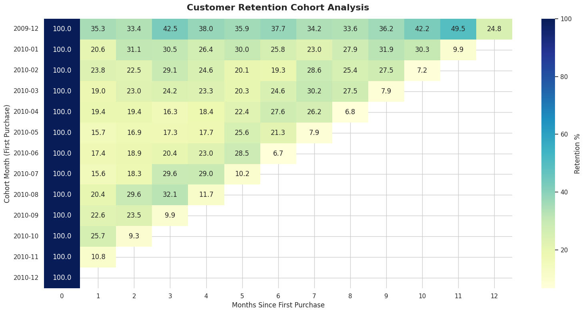
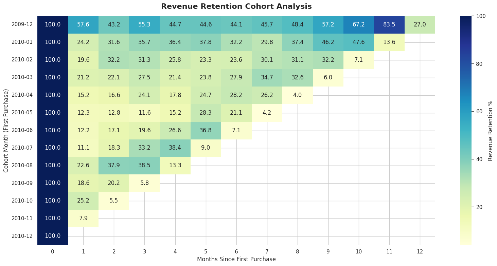

# 📊 E-Commerce Cohort Analysis
**Tools:** Python (Pandas, Matplotlib, Seaborn) | **Environment:** Google Colab

## 📖 Executive Summary
Analyzed 500,000+ transactional records to understand customer retention and revenue churn. This project uncovers behavioral patterns distinguishing one-time buyers from high-value wholesale clients.

## 🛠️ Data Pipeline
- **Raw Data:** 525,461 rows
- **Cleaning:** Dropped 107k+ missing Customer IDs, removed negative quantities (returns), and filtered zero/negative prices.
- **Final Dataset:** 407,664 clean transactions.

## 🧠 The Analysis (Cohort Logic)
1. **Cohort Month:** Assigned each customer to their first purchase month.
2. **Cohort Index:** Calculated the time gap (in months) between their first and subsequent purchases.
3. **Pivot Matrix:** Aggregated unique customers and total revenue per cohort.

## 💡 Key Business Insights
1. **Customer Retention Dip:** Most cohorts lose 75-80% of customers by Month 1. 
2. **The Revenue Paradox:** While customer count drops, **Revenue Retention** for older cohorts (Dec 2009) remains high (83% by Month 11). This indicates a loyal, high-spending B2B/Wholesale segment.
3. **Holiday Acquisition:** Dec 2009 saw the highest customer acquisition (955 new users).

## 📸 Visualizations
*Customer Retention Heatmap*

*Revenue Retention Heatmap*

## 🚀 How to Replicate
1. Open `cohort_analysis.ipynb` in Google Colab.
2. Upload the dataset.
3. Run all cells to generate the matrices and heatmaps.

---
*Created by Shaikh Muhammad Maaz*
